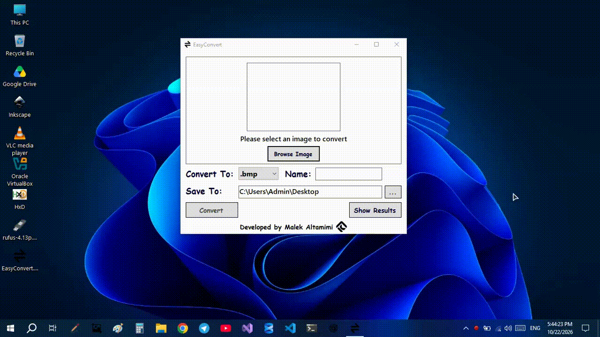

# Easy Convert

**A simple Windows image converter with both a graphical interface and command-line support.**

Easy Convert is a Windows Forms utility for converting images between common formats, including PNG, JPEG, BMP, GIF, and ICO.

It provides two ways to work: use the graphical interface for quick, interactive conversions, or run the application from the command line to integrate image conversion into scripts and other programs.

One of its key features is ICO generation, powered by `IcoBuilder` — a reusable C# class I developed to construct ICO files from image data.

## Preview



## Features

- **Graphical interface:** Convert images through a Windows Forms interface.
- **Command-line interface:** Convert images directly from Command Prompt or other command-line environments.
- **Programmatic integration:** Invoke the executable from scripts and other programs without manually using the GUI.
- **ICO generation:** Create Windows icon files from supported image formats.
- **Reusable `IcoBuilder` class:** Build ICO files by adding images at specified dimensions and saving the resulting file.
- **Common image formats:** Work with PNG, JPEG, BMP, GIF, and ICO.
- **Portable executable:** Run the application without requiring a traditional installer.

## Command-Line Usage

The command-line interface is one of the main features of Easy Convert. It makes image conversion convenient for automation and for programs that need to convert images as part of a larger workflow.

### Syntax

```cmd
EasyConvert.exe <source-image> <destination-image>
```

Provide the source image path and the destination path. The destination file's extension specifies the desired output format.

### Examples

Convert a PNG image to JPEG:

```cmd
EasyConvert.exe input.png .\output.jpg
```

Convert a JPEG image to PNG:

```cmd
EasyConvert.exe photo.jpg .\photo.png
```

Convert a PNG image to a Windows icon:

```cmd
EasyConvert.exe C:\MyFolder\image.png C:\MyOtherFolder\application.ico
```

Display the command-line help:

```cmd
EasyConvert.exe -help
```

> **Note:** Replace the example paths with the actual paths to your images. If a path contains spaces, enclose it in quotation marks.

### Why CLI support?

The CLI was added to make Easy Convert useful beyond interactive desktop use. It allows the converter to be invoked by other programs and scripts, making it easier to incorporate image conversion into development workflows and automated tasks.

## ICO Generation and `IcoBuilder`

Windows ICO files are different from ordinary single-image files. An ICO file contains a directory of image entries, followed by the corresponding image data. It can contain multiple representations of an icon at different dimensions.

To handle this format, I developed `IcoBuilder` from scratch in C#.

Rather than limiting the implementation to Easy Convert's conversion workflow, I designed the class as a reusable component that can be used independently wherever an application needs to construct ICO files.

### How it works

`IcoBuilder` allows callers to:

- Add images to an icon file at specified dimensions.
- Include multiple image entries in a single ICO file.
- Encode the image entries as PNG data.
- Construct the ICO header and directory entries.
- Calculate image-data offsets and write the resulting ICO file to a stream or file path.

The class supports dimensions from 1 to 256 pixels per side; a dimension of `0` represents 256 pixels.

### Example

The following example demonstrates the core API:

```csharp
Image image = Image.FromFile("image.png");

try
{
    IcoBuilder builder = new IcoBuilder();

    // Zero represents a dimension of 256 pixels.
    builder.AddImage(image, 0, 0);

    bool saved = builder.Save("application.ico");
}
finally
{
    image.Dispose();
}
```

This example creates a 256 × 256 PNG-encoded image entry in an ICO file. Additional images can be added at other dimensions before saving to include multiple representations.

The same class can be reused in other C# applications that need to construct ICO files, independently of Easy Convert.

## Supported Formats

Easy Convert focuses on common image formats supported by its conversion implementation.

| Format | Extension |
|---|---|
| PNG | `.png` |
| JPEG | `.jpg` , `.jpeg` , `.jpe` , `.jfif` , `.jif` , `.jfi` |
| Bitmap | `.bmp` , `.dib` |
| GIF | `.gif` |
| Tiff | `.tif` , `.tiff` |
| Windows Icon | `.ico` |

The available conversions depend on the source and destination formats supported by the application. Easy Convert is intended for straightforward, everyday image conversion rather than advanced image processing.

## Getting Started

### Download

**[Download Easy Convert](https://github.com/maketmimi/EasyConvert/releases)**'s executable from the Releases page and run it on Windows.


### Run from the command line

1. Open Command Prompt.
2. Navigate to the directory containing `EasyConvert.exe`, or use the executable's full path.
3. Run a conversion command using the syntax shown above.

For example:

```cmd
EasyConvert.exe "input.png" ".\output.ico"
```

**Requirements:** Windows and a compatible .NET Framework runtime.

## About This Project

Easy Convert is a learning project developed while practicing Windows Forms and C# through the **[Programming Advices roadmap](https://programmingadvices.com/)** by Dr. Mohammed Abu-Hadhoud.

The project provided hands-on experience with building a desktop utility, integrating command-line functionality into a Windows Forms application, and working with image formats.

One of the main technical challenges was supporting both GUI and CLI workflows in the same executable, including handling console interaction. Developing `IcoBuilder` was another important part of the project, providing practical experience with binary file structures and ICO generation.

The goal was to build a useful everyday tool while exploring these concepts in practice.

## Technology

- C#
- Windows Forms
- .NET Framework
- Custom ICO file construction

## License

This project is licensed under the MIT License. See the [LICENSE](LICENSE) file for details.

## Acknowledgments

This project was developed as part of my learning journey through the [Programming Advices roadmap](https://programmingadvices.com/).

## Links

Take a look at [my personal portfolio](https://altamimi.ly)
